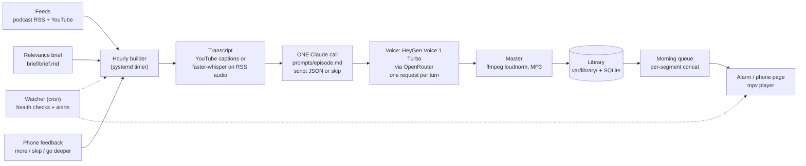

# Daily Brief

A personal wake-up "podcast digest". An hourly builder picks one new episode from the podcasts and YouTube channels you
follow, reads its transcript, has Claude turn it into a short two-host conversation (or decide it is not worth your
morning), voices it, and files the result in a library. At wake-up, the ready episodes are joined into one show and played
by an alarm. You get a 10 to 20 minute briefing on what matters to you instead of a backlog of ten hours of audio.

## The problem

The podcasts worth following are long: 60 to 120 minutes, mostly conversation, with perhaps ten minutes that matter for
your work. Nobody has the time, so the queue only grows. Summaries from a chatbot are quick to read but easy to skip.
What works is audio you do not have to schedule: something that plays while you wake up, short enough to finish, and
filtered through what you actually care about.

## Demo

Coming soon. The sample audio will live at `demo/demo.mp3`; it does not exist yet. The script it will be voiced from,
[`demo/script.json`](demo/script.json), is original and is included now. Once you have an OpenRouter key you can make it
yourself with `bin/voice-demo` (about a cent).

## How it works



1. **Collect.** The builder reads your configured feeds (`[[sources]]` in the config), notes new episodes (published in
   the last `new_window_days`) and older back-catalog ones, and ignores clips and trailers.
2. **Pick one.** It ranks candidates by keyword match between their titles and your relevance brief, never takes more
   than N per creator per day, and chooses a back-catalog episode only when a segment has nothing waiting.
3. **Transcribe.** YouTube: captions only (the video is never downloaded). Podcasts: the RSS audio, transcribed locally
   with faster-whisper.
4. **Write.** One `claude -p` call receives your brief, what you have already heard, your feedback and the transcript.
   It returns a validated JSON script for two hosts (ALEX explains, SAM is the skeptic) or `{"skip": true, "reason": ...}`
   when nothing clears the brief. The script is checked in code (`daily_brief/script.py`: length, turn size, speaker runs,
   banned hype words, no markdown) and gets one retry with the exact error fed back.
5. **Voice.** HeyGen Voice 1 Turbo through OpenRouter, one request per turn, raw 16-bit PCM back. Turns are level-matched,
   joined with short pauses, and the billed cost of each request is read back.
6. **Master.** ffmpeg loudness-normalises to -16 LUFS and writes an MP3 into `var/library/<item>/`.
7. **Assemble.** On the first of: the alarm firing, Play on the phone page, or a request for today's show, the ready
   episodes are concatenated per segment (A, then B) into that day's show, up to `max_segment_minutes`. Episodes built
   later go to the next morning.
8. **Play and react.** `mpv` plays the show; the phone page (served by the API) shows what is in it and takes feedback.

## Design decisions

- **One Claude call per episode.** Early designs separated "extract ideas", "edit", "write script". Each stage re-read
  the transcript and each hand-off lost nuance. One call that decides, selects and writes keeps the arc coherent and is
  one failure point instead of three. The validator, not extra calls, enforces the rules.
- **Per-episode, hourly, instead of a nightly batch.** A nightly job had a deadline, a retry window and a "what if
  tonight failed" backup path. Building one episode takes minutes, so the builder now runs every hour and failure just
  means "try again next hour". Any single hour can fail; the morning does not depend on it.
- **A library, not a deadline.** Finished episodes wait in the library until a morning claims them. A ready queue is
  itself the backup: if the builder is down for a day, yesterday's surplus plays.
- **The spend cap is checked before any LLM call.** Today's billed voice spend plus an estimate for this episode must fit
  under `daily_cap_usd`; if not, the run stops with `capped` before spending a Claude call or a request.
- **A skip is a result, and it is final.** An off-brief episode costs one Claude call and no voice, is stored as
  `skipped`, and is never picked again, so the same unwanted episode cannot burn calls every hour.
- **Failures are charged, then set aside.** A bad script twice or a voice error charges the item one attempt; after
  `build.max_attempts` it is marked failed and ignored. Rate-limited YouTube captions are the exception: they are
  "deferred" without charging an attempt, and do not block other segments.
- **Auth failure stops the run.** If Claude is logged out (`LLMAuthError`), the run stops on the first occurrence,
  charges nothing and records why, rather than failing every candidate in turn.
- **Token-rejected detection.** `claude auth status` only reports whether a login exists; it does not check that the
  long-lived token (`claude setup-token`) is still accepted. So `/health/llm` also reports `loggedIn: false` when the
  most recent build that reached Claude was refused (`tokenRejected`). The watcher alerts on it.
- **Atomic, idempotent assembly.** An episode belongs to exactly one morning; assembling twice changes nothing; a crash
  mid-assembly never leaves a READY marker over half a show.
- **Config over constants.** Every threshold, model id, price, timeout and path is in `config.example.toml`, validated
  at load.

## TTS bake-off: listed price is not billed price

The voice engine was chosen by measurement, not by price sheet. Ten engines voiced the same 8-turn, 1,047-character
dialogue the way production makes requests; cost was read back per request from OpenRouter's generation endpoint, and
accuracy was the word error rate of the audio re-transcribed with faster-whisper.

| Model | Billed $/1M chars | Listed $/1M chars | Words/min |
|---|---|---|---|
| Fish Audio Drama 3 | 2.2 | 2 | 94 (slow) |
| Kokoro 82M | **4.0** | **0.62** | 186 |
| **HeyGen Voice 1 Turbo (chosen)** | 4.0 | 4 | 170 |
| Gemini 3.8 Flash Lite TTS | 10.1 | per audio token | 169 |
| Orpheus 3B | 15.0 | 7 | 165 |
| MAI Voice 2.1 Flash | 15.0 | 15 | 152 |
| Grok Voice TTS 1.0 | 15.0 | 15 | 166 |
| Gemini 3.8 Flash TTS | 16.1 | per audio token | 159 |
| Fish Audio S2.1 Pro | 16.6 | 15 | 151 |

The key finding: **listed is not billed.** Kokoro lists at $0.62 per million characters and billed $4.00, about six
times more, because short per-turn requests hit a per-request floor. A dialogue's cost depends on how many requests it
takes, not just how many characters it has. Word error rate was 2% to 7% for every engine, so accuracy did not
separate them; price, pace (the cheapest engine speaks at 94 words a minute, which stretches a 15-minute script to 28)
and voice quality did. Full method and table: [`docs/tts-bakeoff.md`](docs/tts-bakeoff.md). Prices are from
2026-10-25 and will drift; re-measure before you rely on them.

**Cost per show:** about 12,000 characters per 14-minute episode at about $4 per million characters is **about $0.05
per episode**. The default daily cap is **$0.15**. Claude usage is whatever your Claude Code login costs you (the
author uses a subscription, so there is no per-call bill).

## Reliability design

- The hourly timer is `Persistent=true` with a randomized delay; a missed hour is simply run later.
- Each run records a row (outcome, error, cost) that `/health/show` exposes: last build, failures in a row, queue depth
  and today's spend versus the cap.
- A cron **watcher** (`ops/watcher/`) polls the health endpoints and alerts through any command you give it. Alerts: Claude
  logged out or token rejected, nothing ready for the morning, repeated failed builds, API down. Each alert repeats at
  most every 12 hours and sends RESOLVED when it clears.
- A feed that keeps failing never fails a build (the builder just works from the backlog), so each build records a
  per-feed outcome and `/health/show` reports `feeds_failing` for any feed with no good collect for 24 hours; the
  watcher alerts on it.
- The alarm has a fallback in both directions: if no podcast show is ready it can start your music bridge instead
  (optional, see `[alarm_clock]`), and vice versa.
- Daily upkeep archives each aired show, snapshots the database (feedback, covered-topics ledger, run history) and prunes
  old files.
- Secrets are read from a file, never logged, never placed in an exception message.

## Requirements

- Linux with systemd user units (the units and alarm playback are written for a Linux desktop session)
- Python 3.12+ and [uv](https://docs.astral.sh/uv/)
- `ffmpeg` and `ffprobe` (mastering); `mpv` (playback)
- [Claude Code](https://claude.com/claude-code) CLI, logged in, for `claude -p` and `claude setup-token`
- An [OpenRouter](https://openrouter.ai) API key with a few dollars of credit
- Optional: `yt-dlp`, used only to list a channel when its RSS feed is down
- First run downloads the faster-whisper model (`small.en`) from the Hugging Face hub

## Quick start

```sh
git clone <this repo> daily_brief && cd daily_brief
uv sync

# 1. config: choose your feeds, voices, caps
cp config.example.toml config.toml
$EDITOR config.toml
$EDITOR brief/brief.md            # the relevance brief: rewrite the example for yourself

# 2. secrets: a chmod-600 file OUTSIDE the repo (path = [voice] secrets_file)
mkdir -p ~/.config/daily_brief && umask 077
claude setup-token                # prints a long-lived token
cat > ~/.config/daily_brief/secrets.env <<'EOF'
OPENROUTER_API_KEY=your-openrouter-key
CLAUDE_CODE_OAUTH_TOKEN=token-from-claude-setup-token
EOF
chmod 600 ~/.config/daily_brief/secrets.env

# 3. build one episode now (collects feeds, picks one, calls Claude, voices it)
uv run python -m daily_brief.build config.toml

# 4. run it for real: hourly builder, minute-by-minute alarm tick, phone page/API
bin/install-units
loginctl enable-linger "$USER"    # keep the user units running when logged out
```

The API and phone page listen on `http://127.0.0.1:8765` by default (`[api]` in the config). It has no authentication:
if you want to open it on your phone, bind it to a private network interface or put it behind a VPN or an authenticating
reverse proxy; do not expose it to the internet. The alarm is off until you set it on the phone page or with
`PUT /alarm`.

Useful commands:

```sh
systemctl --user list-timers 'brief-*'
journalctl --user -u brief-build -n 40 -o cat
curl -s localhost:8765/health/show | python3 -m json.tool    # queue, last build, spend vs cap
curl -s localhost:8765/health/llm                             # is Claude logged in, was the token rejected
systemctl --user start brief-build                            # build one episode now
bin/audio-qa config.toml var/library/<item_id>                # word error rate of an episode against its script
bin/check                                                     # tests + lint
```

## Security

- Secrets (`OPENROUTER_API_KEY`, `CLAUDE_CODE_OAUTH_TOKEN`) live in a **chmod-600 file outside the repo**, named by
  `[voice] secrets_file`. `.gitignore` also excludes `*.env`, databases and generated audio.
- The Claude token is passed to the `claude` subprocess through its environment only, never on a command line.
- The API has no auth. Keep it on localhost or a private network.
- Transcripts, scripts and episode audio are derived from other people's content. They stay in `var/`, which is not
  tracked; this repository contains none, and you should not publish yours.

## Repository layout

| Path | What |
|---|---|
| `daily_brief/build.py` | the hourly builder: pick, transcript, Claude, voice, master, library |
| `daily_brief/script.py` | validation of the model's script JSON |
| `daily_brief/voice.py`, `mix.py` | HeyGen via OpenRouter with cost read-back; ffmpeg mastering |
| `daily_brief/queue.py`, `show.py`, `alarm_*.py` | morning assembly, playback, the alarm |
| `daily_brief/api.py`, `phone.html` | FastAPI app and the phone page |
| `prompts/episode.md` | the one prompt |
| `brief/brief.md` | an example relevance brief |
| `systemd/`, `bin/install-units` | user units (with an `@APP_DIR@` placeholder) and their installer |
| `ops/watcher/` | cron watcher with a pluggable `NOTIFY_CMD` |
| `demo/script.json`, `bin/voice-demo` | an original two-host script and the tool that voices it |
| `docs/tts-bakeoff.md` | the TTS measurements |

## Notes and limits

- Built for one listener; there is no multi-user support.
- Respect the terms of the feeds and platforms you use and the copyright of the shows you summarise. This tool creates
  personal summaries for private listening; it does not republish anyone's audio.
- Voice cloning of real people is deliberately not supported.

## License

MIT, see [LICENSE](LICENSE).
