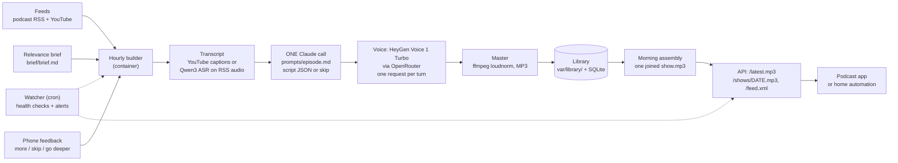

# Daily Brief

A personal wake-up "podcast digest". An hourly builder picks one new episode from the podcasts and YouTube channels you
follow, reads its transcript, has Claude turn it into a short two-host conversation (or decide it is not worth your
morning), voices it, and files the result in a library. Each morning the ready episodes are joined into one MP3, served
as a link (`/latest.mp3`) and as a podcast feed (`/feed.xml`). You get a 10 to 20 minute briefing on what matters to you
instead of a backlog of ten hours of audio. It runs as one Docker container pair; it plays nothing itself.

## The problem

The podcasts worth following are long: 60 to 120 minutes, mostly conversation, with perhaps ten minutes that matter for
your work. Nobody has the time, so the queue only grows. Summaries from a chatbot are quick to read but easy to skip.
What works is audio you do not have to schedule: a file waiting in your podcast app when you wake up, short enough to
finish, and filtered through what you actually care about.

## Demo

[`demo/demo.mp3`](demo/demo.mp3) (97 s, 1.5 MB): the two hosts, weston and meredith, reading an original script,
[`demo/script.json`](demo/script.json). It was voiced by the same code path the builder uses, through HeyGen Voice 1
Turbo on OpenRouter, for about a cent. It measures -16.8 LUFS, and Whisper transcribes it back with a 3.9% word error
rate against the script. To make your own, run `bin/voice-demo` with an OpenRouter key in `secrets.env`.

## How it works



1. **Collect.** The builder reads your configured feeds (`[[sources]]` in the config), notes new episodes (published in
   the last `new_window_days`) and older back-catalog ones, and ignores clips and trailers.
2. **Pick one.** It ranks candidates by keyword match between their titles and your relevance brief, never takes more
   than N per creator per day, and chooses a back-catalog episode only when a segment has nothing waiting.
3. **Transcribe.** YouTube: captions only (the video is never downloaded). Podcasts: the RSS audio, cut into 10-minute
   chunks and transcribed by `qwen/qwen3-asr-0.6b` on OpenRouter (about $0.012 per hour of audio; a 97-minute
   episode took under a minute).
4. **Write.** One `claude -p` call receives your brief, what you have already heard, your feedback and the transcript.
   It returns a validated JSON script for two hosts (ALEX explains, SAM is the skeptic) or `{"skip": true, "reason": ...}`
   when nothing clears the brief. The script is checked in code (`daily_brief/script.py`: length, turn size, speaker runs,
   banned hype words, no markdown) and gets one retry with the exact error fed back.
5. **Voice.** HeyGen Voice 1 Turbo through OpenRouter, one request per turn, raw 16-bit PCM back. Turns are level-matched,
   joined with short pauses, and the billed cost of each request is read back.
6. **Master.** ffmpeg loudness-normalises to -16 LUFS and writes an MP3 into `var/library/<item>/`.
7. **Assemble.** From `[show] assemble_at` (05:00 local by default), or at the first request for today's MP3, the ready
   episodes are concatenated per segment (A, then B), up to `max_segment_minutes`, and joined into
   `var/show/<date>/show.mp3`. Episodes built later go to the next morning.
8. **Serve and react.** The API serves `/latest.mp3`, `/shows/<date>.mp3` and `/feed.xml`. Subscribe to the feed in any
   podcast app, or point home automation at `/latest.mp3`. Each episode is also published on its own the moment it is
   built, in `/episodes.xml` (newest first, `/episodes/<item>.mp3`) and `/episodes/latest.json`. The small page at `/`
   shows what is in the show and takes feedback (more, skip, go deeper).

## Design decisions

- **One Claude call per episode.** Early designs separated "extract ideas", "edit", "write script". Each stage re-read
  the transcript and each hand-off lost nuance. One call that decides, selects and writes keeps the arc coherent and is
  one failure point instead of three. The validator, not extra calls, enforces the rules.
- **Per-episode, hourly, instead of a nightly batch.** A nightly job had a deadline, a retry window and a "what if
  tonight failed" backup path. Building one episode takes minutes, so the builder now runs every hour and failure just
  means "try again next hour". Any single hour can fail; the morning does not depend on it.
- **A library, not a deadline.** Finished episodes wait in the library until a morning claims them. A ready queue is
  itself the backup: if the builder is down for a day, yesterday's surplus goes into the next show.
- **It makes the file and stops there.** Playback (alarms, speakers, a phone) is a different problem. The output is a
  stable URL and a standard podcast feed, so whatever you already use to play audio can consume it.
- **The spend cap is checked before any LLM call.** Today's billed voice and speech-to-text spend plus an estimate for this episode
  must fit under `daily_cap_usd` (the speech-to-text cost of one episode, a few cents at most, can push past it); if not, the run stops with `capped` before spending a Claude call or a request.
- **Provider outages are never the episode's fault.** Voice or speech-to-text 429/5xx/timeouts/401/402/403 and Claude timeouts, overload
  or usage limits are not charged to the episode and stop the hour's run (the next hour retries). A validated script is
  cached in `var/library/<id>/script.json`, so a failed voice step never pays for Claude twice.
- **A skip is a result, and it is final.** An off-brief episode costs one Claude call and no voice, is stored as
  `skipped`, and is never picked again, so the same unwanted episode cannot burn calls every hour.
- **Failures are charged, then set aside.** A bad script twice or a voice error charges the item one attempt; after
  `build.max_attempts` it is marked failed and ignored. Rate-limited YouTube captions are the exception: they are
  "deferred" without charging an attempt, and do not block other segments.
- **Auth failure stops the run.** If Claude is logged out (`LLMAuthError`), the run stops on the first occurrence,
  charges nothing and records why, rather than failing every candidate in turn.
- **Token-rejected detection.** `claude auth status` only reports whether a login exists; it does not check that the
  long-lived token (`claude setup-token`) is still accepted. So `/health/llm` also reports `loggedIn: false` when the
  most recent build that reached Claude was refused (`tokenRejected`). The watcher alerts on it.
- **Atomic, idempotent assembly.** An episode belongs to exactly one morning; assembling twice changes nothing; a crash
  mid-assembly never leaves a READY marker over half a show.
- **Config over constants.** Every threshold, model id, price, timeout and path is in `config.example.toml`, validated
  at load.

## TTS bake-off: listed price is not billed price

The voice engine was chosen by measurement, not by price sheet. Ten engines voiced the same 8-turn, 1,047-character
dialogue the way production makes requests; cost was read back per request from OpenRouter's generation endpoint, and
accuracy was the word error rate of the audio re-transcribed with faster-whisper.

| Model | Billed $/1M chars | Listed $/1M chars | Words/min |
|---|---|---|---|
| Fish Audio Drama 3 | 2.2 | 2 | 94 (slow) |
| Kokoro 82M | **4.0** | **0.62** | 186 |
| **HeyGen Voice 1 Turbo (chosen)** | 4.0 | 4 | 170 |
| Gemini 3.8 Flash Lite TTS | 10.1 | per audio token | 169 |
| Orpheus 3B | 15.0 | 7 | 165 |
| MAI Voice 2.1 Flash | 15.0 | 15 | 152 |
| Grok Voice TTS 1.0 | 15.0 | 15 | 166 |
| Gemini 3.8 Flash TTS | 16.1 | per audio token | 159 |
| Fish Audio S2.1 Pro | 16.6 | 15 | 151 |

The key finding: **listed is not billed.** Kokoro lists at $0.62 per million characters and billed $4.00, about six
times more, because short per-turn requests hit a per-request floor. A dialogue's cost depends on how many requests it
takes, not just how many characters it has. Word error rate was 2% to 7% for every engine, so accuracy did not
separate them; price, pace (the cheapest engine speaks at 94 words a minute, which stretches a 15-minute script to 28)
and voice quality did. Full method and table: [`docs/tts-bakeoff.md`](docs/tts-bakeoff.md). Prices are from
2026-10-25 and will drift; re-measure before you rely on them.

**Cost per show:** about 12,000 characters per 14-minute episode at about $4 per million characters is **about $0.05
per episode**, plus about $0.012 per hour of podcast audio transcribed (YouTube captions are free). The default
daily cap is **$0.15**. Claude usage is whatever your Claude Code login costs you (the
author uses a subscription, so there is no per-call bill).

## Reliability design

- The builder container runs `python -m daily_brief.every`, which starts a fresh build process at each hourly boundary
  with a run timeout; a failed or hung run is logged and the next hour tries again. Compose restarts a stopped container.
- Each run records a row (outcome, error, cost) that `/health/show` exposes: last build, failures in a row, queue depth
  and today's spend versus the cap.
- A cron **watcher** (`ops/watcher/`) polls the health endpoints and alerts through any command you give it. Alerts: Claude
  logged out or token rejected, nothing ready for the morning, repeated failed builds, API down. Each alert repeats at
  most every 12 hours and sends RESOLVED when it clears.
- A feed that keeps failing never fails a build (the builder just works from the backlog), so each build records a
  per-feed outcome and `/health/show` reports `feeds_failing` for any feed with no good collect for 24 hours; the
  watcher alerts on it.
- When every feed fails (no network), the run records an `offline` outcome and makes no Claude or voice calls at all.
- Daily upkeep archives each assembled show, snapshots the database (feedback, covered-topics ledger, run history) and prunes
  old files.
- Secrets are read from a file, never logged, never placed in an exception message.

## Requirements

- Docker with the Compose plugin (the image bundles Python, ffmpeg, Node, the Claude Code CLI and yt-dlp)
- A Claude login for `claude -p`, either way:
  - `CLAUDE_CODE_OAUTH_TOKEN` from `claude setup-token` (uses your Claude subscription), or
  - `ANTHROPIC_API_KEY` (pay per use)
- An [OpenRouter](https://openrouter.ai) API key with a few dollars of credit, for the voices and speech-to-text
- About 2 GB of disk for the image, plus a few hundred MB a week of audio

## Quick start

```sh
git clone <this repo> daily_brief && cd daily_brief

# 1. config: choose your feeds, voices, caps; rewrite the example relevance brief for yourself
cp config.example.toml config.toml
$EDITOR config.toml brief/brief.md

# 2. secrets: one KEY=value file, mounted read-only into the containers
touch secrets.env && chmod 600 secrets.env
$EDITOR secrets.env
#   OPENROUTER_API_KEY=your-openrouter-key
#   CLAUDE_CODE_OAUTH_TOKEN=token-from-claude-setup-token      (or ANTHROPIC_API_KEY=...)

# 3. start the API and the hourly builder
mkdir -p var
docker compose up -d
```

`brief/brief.md` is baked into the image as the seed brief (later revisions are drafted and approved through the web
page and live in `var/`), so rebuild with `docker compose up -d --build` after changing it.

If you use `claude setup-token`, run it on any machine where Claude Code is logged in, then paste the token into
`secrets.env`. Edit that file in place (an editor that saves in place, not one that replaces the file), because compose
mounts the single file.

The builder runs once when it starts and then at each wall-clock hour, so with working keys the first episode shows up
within minutes. To build one by hand:

```sh
docker compose exec builder python -m daily_brief.build /app/config.toml
```

The API listens on `http://127.0.0.1:8765` (change the port with `BRIEF_PORT` in a `.env` file). It has no
authentication, so compose publishes it on localhost only. To reach it from a phone, put it behind a VPN or an
authenticating reverse proxy; do not expose it to the internet. Set `[feed] base_url` to the public URL you use so the
feed's enclosure links resolve in your podcast app.

Useful commands:

```sh
curl -s localhost:8765/health/show | python3 -m json.tool    # queue, last build, spend vs cap
curl -s localhost:8765/health/llm                             # is Claude logged in, was the token rejected
curl -o today.mp3 localhost:8765/latest.mp3                   # today's show, or the newest one
curl -s localhost:8765/feed.xml                               # the podcast feed
curl -s localhost:8765/episodes.xml                           # every built episode, before the morning show
curl -s localhost:8765/episodes/latest.json                   # the newest episode: id, title, mp3 url
docker compose logs -f builder                                # the hourly runs
docker compose --profile test run --rm test                   # the test suite in the image
```

### Home Assistant and Music Assistant

Daily Brief only publishes files; it never plays anything. Two ways to reach the episodes from a smart home:

- **Music Assistant:** add a *Podcast RSS Feed* provider for `<base_url>/episodes.xml` (and one for `/feed.xml` if you
  want the assembled morning show). The episodes then appear under Podcasts on every Music Assistant player, and in Home
  Assistant's media browser. Music Assistant re-reads a feed at most hourly; to see a new episode sooner, call its
  `music/sync` command when `/episodes/latest.json` changes.
- **Home Assistant feedreader:** point a feedreader entry at `<base_url>/episodes.xml`. Each new episode fires an
  `event.<name>` entity whose `link` is the episode's MP3 URL, so an automation can pass it to `media_player.play_media`.
  Feedreader remembers entries it has seen, even across removing and re-adding the entry, and polls hourly by default.

Without Docker you can still develop: `uv sync`, `bin/check` (tests and lint), and run the modules directly with a config
whose paths point at your own directories.

## Security

- Secrets (`OPENROUTER_API_KEY`, `CLAUDE_CODE_OAUTH_TOKEN` or `ANTHROPIC_API_KEY`) live in a **chmod-600 `secrets.env`**
  that is mounted read-only at `/app/secrets.env` (`[voice] secrets_file`). `.gitignore` and `.dockerignore` exclude
  `*.env`, `config.toml`, databases and generated audio, so none of it enters git or the image.
- The Claude token is passed to the `claude` subprocess through its environment only, never on a command line.
- The API has no auth. Compose publishes it on `127.0.0.1` only; keep it on localhost or a private network.
- Transcripts, scripts and episode audio are derived from other people's content. They stay in `var/`, which is not
  tracked; this repository contains none, and you should not publish yours.

## Repository layout

| Path | What |
|---|---|
| `daily_brief/build.py` | the hourly builder: pick, transcript, Claude, voice, master, library |
| `daily_brief/script.py` | validation of the model's script JSON |
| `daily_brief/voice.py`, `mix.py` | HeyGen via OpenRouter with cost read-back; ffmpeg mastering |
| `daily_brief/queue.py` | morning assembly into one `show.mp3` |
| `daily_brief/api.py`, `phone.html` | FastAPI app (MP3, feed, health) and the small web page |
| `daily_brief/every.py` | the builder container's hourly scheduler |
| `prompts/episode.md` | the one prompt |
| `brief/brief.md` | an example relevance brief |
| `Dockerfile`, `docker-compose.yml` | one image, services `api` and `builder`, plus a `test` profile |
| `bin/release` | for a host that deploys from git: tag, test in the image, `up -d`, wait for `/health` |
| `ops/watcher/` | cron watcher with a pluggable `NOTIFY_CMD` |
| `demo/script.json`, `bin/voice-demo` | an original two-host script and the tool that voices it |
| `docs/tts-bakeoff.md` | the TTS measurements |

## Notes and limits

- Built for one listener; there is no multi-user support.
- Respect the terms of the feeds and platforms you use and the copyright of the shows you summarise. This tool creates
  personal summaries for private listening; it does not republish anyone's audio.
- Voice cloning of real people is deliberately not supported.

## License

MIT, see [LICENSE](LICENSE).
